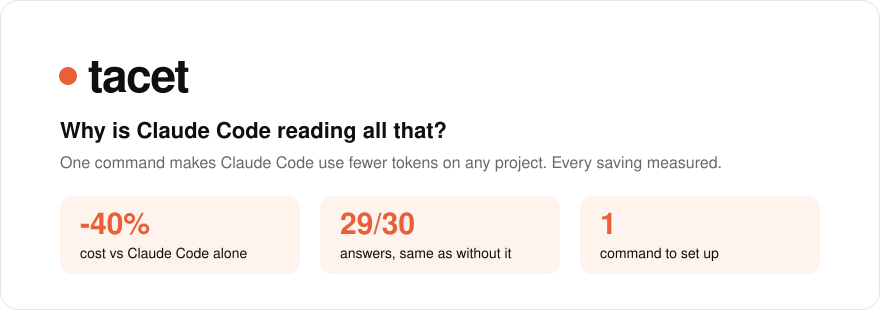
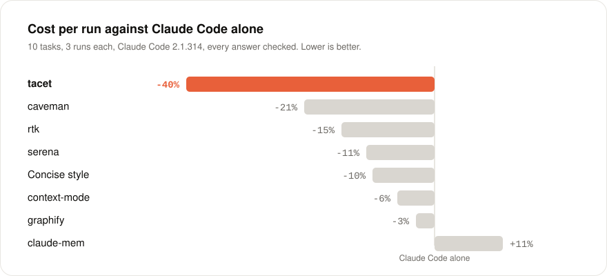
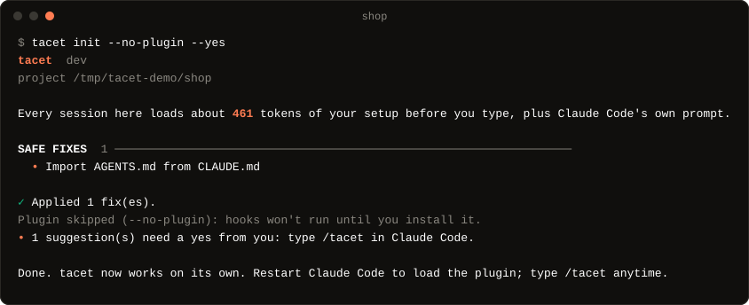

<p align="center">
  <picture>
    <source media="(prefers-color-scheme: dark)" srcset="docs/assets/hero-dark.svg">
    
  </picture>
</p>

<p align="center">
  <a href="https://github.com/RhythmShahriar/tacet/releases/latest"></a>
  <a href="https://www.npmjs.com/package/@rhythmsh/tacet"></a>
  <a href="https://github.com/RhythmShahriar/tacet/actions/workflows/ci.yml"></a>
  <a href="LICENSE"></a>
  <a href="go.mod"></a>
</p>

<p align="center">
  <a href="#install">Install</a> ·
  <a href="#how-it-works">How it works</a> ·
  <a href="#results">Results</a> ·
  <a href="#what-it-does">What it does</a> ·
  <a href="#honest-limits">Honest limits</a> ·
  <a href="docs/benchmark.md">Benchmark</a>
</p>

<br>

Claude Code rereads its whole context on every turn: your `CLAUDE.md`, every tool, every document it opened. tacet trims what it loads and what it reads. Run `tacet init` once in a project. From then on it works through Claude Code's own hooks: long PDFs open on an outline, code is found by symbol, secrets stay out and a new session picks up where the last one stopped.

```sh
curl -fsSL https://rythm.sh/tacet/install.sh | sh    # or: npm i -g @rhythmsh/tacet
cd your-project && tacet init
```

## Results

<p align="center">
  <picture>
    <source media="(prefers-color-scheme: dark)" srcset="docs/assets/bench-dark.svg">
    
  </picture>
</p>

Head to head with the six most popular tools of its kind, on nine tasks: questions about a 43-page PDF and a Word file, finding code in Go, Python and Rust, fixing failing tests and continuing a half-done change. Every tool ran at its defaults, three times per task, with every answer checked. tacet is the cheapest on seven of the nine tasks and got all 27 answers right; rtk is cheaper on continuing a change and serena on fixing a Rust test.

Every number in this README comes from runs anyone can repeat with one command: [method, per-task results and raw data](docs/benchmark.md#against-other-tools).

## How it works

1. **Measure.** `tacet init` adds up what every session loads before you type and what your past sessions billed. That becomes the baseline.
2. **Fix what is safe.** It applies only changes it can undo, after one yes. Everything else waits as a suggestion you accept or dismiss with `/tacet` inside Claude Code.
3. **Work on its own.** A Claude Code plugin runs tacet at the right moments: when a file is read, a search runs, a prompt names a document, a session compacts or ends.
4. **Prove it.** `/tacet`, `tacet status` and `tacet report` show what was saved against the baseline, from your own sessions.

<p align="center">
  
</p>

## What it does

| | |
|---|---|
| **Long documents open small** | A PDF, Word, PowerPoint or Excel file is converted to Markdown once and opens on an outline plus the sections that match your request. A 28-page PDF question costs 56% fewer tokens. |
| **Code found by symbol** | A code map of Go, TypeScript, Python, Rust and nine more languages answers "where is this defined and who calls it" without a grep through the tree. Up to 81% cheaper on a big repo. |
| **Office and audio files work** | Claude Code refuses Word, PowerPoint, Excel and audio files outright. tacet converts the document or transcribes the voice note as soon as your prompt names it. |
| **Secrets stay out** | Reads of `.env` files, keys and credentials are blocked. So are commands like `cat .env`, each with a reason Claude Code can act on. |
| **Sessions continue** | Before a compact and at session end tacet writes `SESSION.md` from the transcript and git. The next session gets it when you ask to carry on. |
| **Instruction files stay lean** | `CLAUDE.md`, `AGENTS.md` and rules files are checked for stale paths, duplicates and procedures that belong in a skill. Repeated requests become skill drafts. |
| **Updates you approve** | `tacet update` checks the release signature and checksum before it replaces anything. It never runs without your yes. |

## Install

| On | Run |
|---|---|
| macOS, Linux | `curl -fsSL https://rythm.sh/tacet/install.sh \| sh` |
| Windows | `irm https://rythm.sh/tacet/install.ps1 \| iex` |
| Homebrew | `brew install rhythmshahriar/tap/tacet` |
| Scoop | `scoop bucket add rhythmshahriar https://github.com/RhythmShahriar/scoop-bucket` then `scoop install tacet` |
| npm | `npm i -g @rhythmsh/tacet` (or `npx @rhythmsh/tacet init`) |
| Go | `go install -tags gotreesitter_no_copyleft github.com/RhythmShahriar/tacet/cmd/tacet@latest` |

Then, in each project:

```sh
tacet init
```

Restart Claude Code and type `/tacet` to see what it saved. It works the same in the terminal and in the VS Code extension.

<details>
<summary>How the installs are checked</summary>

The install scripts download the build for your system from the latest release, check it against the release's `checksums.txt` and, when [cosign](https://github.com/sigstore/cosign) is installed, check that `checksums.txt` was signed by tacet's release workflow. They install to `~/.local/bin` (Windows: `%LOCALAPPDATA%\Programs\tacet`); set `TACET_INSTALL_DIR` for another folder or `TACET_VERSION` for a specific version.

The npm package is a few kilobytes: on first run it downloads the binary for your system from the release, checks it against the SHA-256 published with the package and keeps it in your user cache. The package carries npm provenance.

`tacet update` replaces a binary from the install scripts; for Homebrew, Scoop, npm and Go it prints the command to update with instead. To check a release archive by hand, run [`scripts/verify-release.sh`](scripts/verify-release.sh) next to the archive, `checksums.txt` and `checksums.txt.sigstore.json`.

</details>

## Results per feature

Each feature is measured on its own with A/B runs through `claude -p`, with and without tacet. A feature that doesn't save tokens without hurting answers is removed or ships off.

| Feature | Scenario | Tokens | Cost | Correct (with / without) |
|---|---|---|---|---|
| Documents | Question about one part of a 28-page PDF | **-56%** | **-65%** | 3/3 / 3/3 |
| Documents | Facts from start, middle and end of a 28-page PDF, plus a summary | **-69%** | **-72%** | 3/3 / 3/3 |
| Documents | Question about one part of a Word file | **-63%** | **-46%** | 3/3 / 3/3 |
| Handoff | "Continue where we left off" with a half-done change | **-45%** | **-26%** | 2/3 / 2/3 |
| Code map | Where a widely used function is defined and called, 430-file repo | **-57%** | **-81%** | 3/3 / 3/3 |
| Code map | Same, for a name grep finds at once | +3% | -10% | 3/3 / 3/3 |
| Audio | What a voice note says (one run each; without tacet it can't be done) | -34% | -70% | 1/1 / 0/1 |

Denying reads of lockfiles and build output was measured too and removed: it saved nothing and blocked answers. Lint feedback after edits and a test gate before finishing ship off, because they showed no gain.

## Honest limits

- **Token counts are estimates.** `tacet measure`, `tacet status` and the report count tokens offline. They are close, not exact.
- **Billed savings need data.** `tacet status` compares main-session requests only and shows a figure after 20 of them since init. Subagent usage is listed on its own line.
- **Savings depend on your setup.** A project with a short `CLAUDE.md` and no documents has little to save.
- **Office files must be named.** Claude Code refuses them before any hook runs, so tacet helps when your prompt names the file or the file is in the repo when the session starts.
- **Scanned PDFs pass through.** A PDF with no text layer is read by Claude Code as usual.
- **Claude Code only, for now.** Codex and Cursor are on the [roadmap](ROADMAP.md).

## Privacy

tacet runs on your machine and reads only your project, its Claude Code settings and its local transcripts. It sends nothing about your project anywhere. It uses the network for two things: the one-time download of the speech engine and model for audio (you start it with `tacet transcribe --setup`; it is checked against pinned checksums) and a check for a newer release on GitHub, at most once a day, which only asks. Set `update: notify` or `update: off` in `~/.config/tacet/config.yaml`, or `TACET_NO_UPDATE_NOTIFIER=1`, to quiet or stop it. It never runs in CI. Its state lives in `.tacet/` in your project, kept out of git through `.git/info/exclude`.

## FAQ

<details>
<summary>Does it change my files?</summary>

Only after a yes and only with changes it can undo: `tacet undo` reverts the last one and `tacet uninstall` reverts all of them. It writes its own state to `.tacet/` and, when a session ends, `SESSION.md`; both stay out of git.

</details>

<details>
<summary>How is it different from rtk, caveman or claude-mem?</summary>

Those tools each work on one thing: shorter command output, shorter replies, memory between sessions. tacet works on what Claude Code loads and reads across documents, code, instruction files and sessions. It keeps only the features that measured a saving. In the head-to-head above tacet cost 38% less than Claude Code alone; the others ranged from 9% less to 13% more.

</details>

<details>
<summary>Does it slow Claude Code down?</summary>

A hook call takes about 10 milliseconds. Converting a document happens once and is cached; the next read is instant.

</details>

<details>
<summary>Does it work in VS Code?</summary>

Yes. The plugin, `/tacet` and the hooks work the same in the VS Code extension as in the terminal. The optional statusline segment (`tacet statusline --install`) shows only in the terminal, not in the VS Code extension.

</details>

## Reference

<details>
<summary>Commands</summary>

Most people only run `tacet init`. For a look or a change:

| Command | Does |
|---|---|
| `tacet` or `tacet status` | what tacet saved and what is waiting for you |
| `tacet report` | writes `.tacet/report.html` and opens it (`--no-open` to skip): savings since init, usage and estimated cost by day, model and tool for the last 14 days |
| `tacet statusline --install` | adds tokens saved today, cache hits, context and rate limits to Claude Code's statusline, terminal only (`--chain` keeps a statusline you already have) |
| `tacet measure` | context loaded at startup and what past sessions billed |
| `tacet audit` | setup findings, each with a fix |
| `tacet docs lint` | checks `CLAUDE.md`, `AGENTS.md` and rules files (`fix`, `init` and `sync` change them) |
| `tacet skills new "<what>"` | drafts a skill from a description (or the latest session with `--from-session`) and writes it after a yes |
| `tacet skills add <owner/repo/path[@ref]>` | imports a public skill pinned to a commit after a yes; never overwrites, refuses scripts unless `--allow-scripts` (`--list` shows examples) |
| `tacet skills check` | skills that never trigger, run long or overlap, with the startup tokens each fix saves |
| `tacet on <feature>` / `tacet off <feature>` | turns a feature on or off for this project |
| `tacet undo` | reverts tacet's last change |
| `tacet uninstall` | removes tacet from this project and restores your files |
| `tacet update` | installs the latest release after a yes, once its signature and checksum verify (`--rollback` restores the previous binary) |

Every command takes `--json` for machine output, `-y` to skip prompts and `-C <dir>` to run in another folder.

</details>

<details>
<summary>Features</summary>

| Feature | Default | What it does |
|---|---|---|
| `convert` | on | PDF and Office files read as Markdown, long ones on an outline of their sections |
| `guard` | on | blocks reads of secrets |
| `handoff` | on | `SESSION.md` written before compact and at session end |
| `audio` | on | audio read as a transcript, asking before the first download |
| `map` | on | code map for the MCP tools |
| `skills` | on | suggests skills from repeated instructions |
| `budget` | off | tells you once per threshold (80% and 100% by default) when a session nears its token budget, set as `budget: {session_tokens: 2000000, warn_at: [0.8, 1.0]}`; never blocks |
| `bigoutput` | off | experimental: keeps long Bash and WebFetch output in `.tacet/out` and shows the agent the start, the end and the errors |
| `feedback` | off | runs the project's own linter or type checker (ruff, pyright, cargo check, tsc, go vet) on each edited file and shows the agent only the failures |
| `terse` | off | selects the `tacet:terse` output style: results first, no preamble or recap, no file contents repeated back, every fact and path kept |
| `lesscode` | off | selects the `tacet:lesscode` output style: `terse` plus the smallest change that works and no speculative abstractions |
| `testgate` | off | runs the tests when the agent tries to finish after editing code and sends it back on failures, at most twice a session |
| `subagents` | off | runs the built-in Explore subagent on Haiku through a project agent file (`.claude/agents/explore.md`): cheaper searches that may miss on hard ones; general-purpose and Plan stay on the main model |

The same switches live in `.tacet/config.yaml`, with `audit_every` for the number of sessions between quiet re-audits and `budget` for the budget thresholds.

</details>

<details>
<summary>CI</summary>

`tacet check` runs the docs lint and the audit and exits 1 on a finding at or above `--fail-on` (high, medium, low or info; default medium). It judges only what is in the repository.

```yaml
- uses: actions/setup-go@v5
  with:
    go-version: stable
- run: go install -tags gotreesitter_no_copyleft github.com/RhythmShahriar/tacet/cmd/tacet@latest
- run: tacet check --fail-on medium
```

Exit codes: 0 ok, 1 a finding at or above `--fail-on`, 2 usage error, 3 any other error.

</details>

<details>
<summary>Uninstall</summary>

In each project where you ran `tacet init`:

```sh
tacet uninstall
```

It reverts every change tacet made there, removes the Claude Code plugin and the `/tacet` skill and deletes `.tacet/`. Then remove the binary the way you installed it:

| Installed with | Remove with |
|---|---|
| Install script | delete `tacet` from the folder it used (`~/.local/bin`, Windows: `%LOCALAPPDATA%\Programs\tacet`) |
| Homebrew | `brew uninstall --cask tacet` |
| Scoop | `scoop uninstall tacet` |
| npm | `npm uninstall -g @rhythmsh/tacet`, then delete the cached binary in `~/.cache/tacet/npm` (`~/Library/Caches/tacet/npm` on macOS, `%LOCALAPPDATA%\tacet\npm` on Windows) |
| Go | delete `tacet` from `$(go env GOPATH)/bin` |

</details>

## Contributing

```sh
git clone https://github.com/RhythmShahriar/tacet && cd tacet
make build         # bin/tacet
make hooks         # Conventional Commits check
make check         # lint, headers and tests
make test-scripts  # the install and release scripts against local fixtures
```

See [CONTRIBUTING.md](CONTRIBUTING.md) for how features are measured before they ship. What comes next is in the [ROADMAP](ROADMAP.md). Found a vulnerability? Please [report it privately](https://github.com/RhythmShahriar/tacet/security/advisories/new).

## License

MIT. The binary links Go modules under the Apache License 2.0 and embeds a WebAssembly build of PDFium. Release archives carry their license and NOTICE files under `THIRD_PARTY/`; [THIRD_PARTY/README.md](THIRD_PARTY/README.md) lists them.

<p align="center"><sub>Made by Rhythm Shahriar</sub></p>
